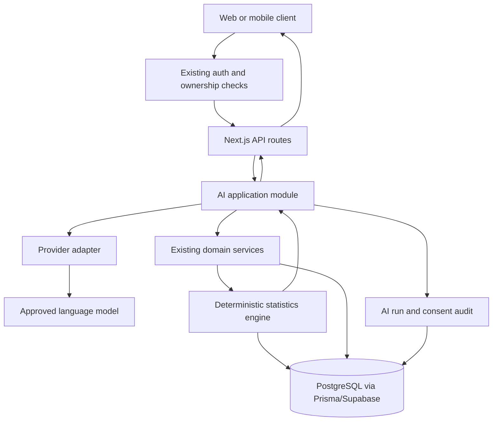

# Datalyst AI Platform Roadmap

> **Status:** Approved direction
> **Destination:** Turn Datalyst into an AI-native personal science platform without replacing its deterministic statistics engine.
> **Primary product statement:** Datalyst is an AI personal science copilot that turns everyday observations into evidence-backed experiments and next actions.

## 1. Executive decision

Datalyst will become AI-native through an **AI control plane over a deterministic evidence layer**.

The statistics engine remains the source of truth for:

- correlations
- p-values
- trends
- experiment results
- sample sizes
- data-quality warnings
- causal limitations

AI will operate above that layer to help the user:

1. Define what to track.
2. Log data in natural language.
3. Understand verified statistical results.
4. Design N-of-1 experiments.
5. Choose the next highest-value observation or action.

The AI must not invent statistics, silently mutate user data, or make medical diagnoses.

## 2. Strategic thesis

### The product wedge

> **AI personal science for people who want to understand what actually changes their life.**

Datalyst is not another chatbot and not another streak tracker. Its defensible loop is:

```text
Observe → Structure → Analyze → Explain → Experiment → Learn
```

The product becomes meaningfully worse without AI because users must otherwise design protocols, enter structured data, interpret statistical output, and plan experiments manually.

### Why this architecture is correct

- It uses the existing Datalyst assets: protocols, templates, entries, statistical analysis, correlations, experiments, and user authentication.
- It avoids rebuilding the product as an agent platform.
- It keeps evidence auditable.
- It allows models and providers to change without rewriting product logic.
- It gives users a visible reason to trust Datalyst: AI convenience with statistical restraint.

## 3. Non-negotiable principles

1. **Evidence before language.** AI explains computed evidence. It does not compute evidence.
2. **Proposal before mutation.** AI proposes protocols, entries, and experiments. The user confirms before data changes.
3. **No medical claims.** Datalyst is a personal analytics and experimentation product, not a diagnostic or treatment system.
4. **User data is sensitive.** Habits, journals, correlations, and health-adjacent data receive strict privacy treatment.
5. **Provider-neutral product code.** No feature may depend directly on one model vendor.
6. **Server-side model access only.** API keys and provider credentials never enter the browser or mobile bundle.
7. **No raw sensitive data in logs.** Prompts, model responses, and user entries must not be sent to console logs, error trackers, or analytics by default.
8. **One modular monolith first.** Do not introduce microservices, queues, vector databases, or autonomous tool agents until measured load or product boundaries justify them.
9. **The user can correct the model.** Corrections are first-class product feedback, not silent failures.
10. **Every user-facing conclusion has provenance.** The UI must show what data and method support the conclusion.

## 4. Target user journey

### First session

1. User states a goal in plain language.
2. AI proposes a small tracking protocol.
3. User edits and confirms the protocol.
4. Datalyst creates the protocol using the existing habit and template domain.
5. User sees the first daily check-in immediately.

### Daily use

1. User logs with a form or natural language.
2. AI extracts candidate values and shows a confirmation preview.
3. User confirms or corrects the values.
4. Datalyst stores the structured entry.
5. The system tells the user what observation is most useful next.

### After enough data

1. The deterministic stats engine calculates correlations and quality signals.
2. Datalyst builds an evidence packet.
3. AI explains the packet in plain language.
4. AI labels uncertainty, confounding, and non-causal interpretation.
5. User can dismiss the insight or create an experiment proposal.

### Experiment loop

1. AI proposes a hypothesis and intervention.
2. User reviews the design.
3. Existing Lab functionality runs the experiment.
4. The statistics engine computes the result.
5. AI summarizes the result and recommends the next decision.

## 5. System design

### 5.1 High-level architecture



### 5.2 Recommended architecture pattern

Use a **modular monolith with a small hexagonal boundary around AI providers**.

```text
src/
├── ai/
│   ├── application/       # use cases: propose, parse, explain, plan
│   ├── domain/            # AI artifact types and policy decisions
│   ├── evidence/          # deterministic evidence packet builders
│   ├── providers/         # provider-neutral interface and adapters
│   ├── prompts/           # versioned prompt templates
│   ├── schemas/           # Zod input/output contracts
│   └── safety/            # consent, redaction, limits, refusals
├── services/              # existing domain services
├── stats/                 # existing deterministic statistics
├── app/api/ai/            # authenticated HTTP adapters
└── lib/                   # existing auth, Prisma, logging, utilities
```

The exact directory names can be adjusted to match the surrounding code. The boundary matters more than the folder name:

- `ai/application` may call `services`, `stats`, and `lib`.
- `stats` must not import an LLM provider.
- Provider adapters must not access Prisma directly.
- API routes must not contain prompt logic.
- UI components must not call providers directly.

### 5.3 Request flow

```text
Request
  → authenticate user
  → authorize owned resources
  → resolve consent and budget
  → build minimal context
  → call deterministic domain/evidence services
  → send structured context to provider
  → validate model output with Zod
  → attach evidence references
  → persist only the approved artifact and safe metadata
  → return response
```

## 6. Core AI capabilities

### Capability A: AI Protocol Builder

**Input:** User goal, constraints, optional existing habits and templates.

**Output:** A protocol proposal containing:

- goal statement
- proposed variables
- variable types and units
- schedule
- expected observation period
- rationale
- assumptions
- optional experiment direction

**Rules:**

- AI may propose but never silently create a protocol.
- Proposed variables must map to supported Datalyst types or be marked unsupported.
- The UI must show the exact fields that will be created.
- User confirmation is required before persistence.

**Success signal:** More users reach a valid first protocol with less manual setup.

### Capability B: Natural-Language Entry Drafts

**Input:** User text such as: `Slept six hours, quality four, two coffees after lunch, low energy.`

**Output:** A draft containing:

- candidate habit/subvariable matches
- normalized values
- date/time assumptions
- missing fields
- confidence per extraction
- clarification questions

**Rules:**

- Drafts require confirmation before saving.
- Ambiguous values become questions, not guesses.
- Unknown concepts are preserved as unresolved text instead of forced into a field.
- The raw text is not retained by default after the structured entry is confirmed.

**Success signal:** Lower median time to complete the Daily Check-in without increasing correction or deletion rates.

### Capability C: Evidence-Backed Insight Explanations

**Input:** A deterministic evidence packet from the stats engine.

**Output:**

- concise finding
- strength and direction
- sample size
- method and statistical significance
- what the result does not prove
- possible confounders
- recommended next experiment or observation

**Rules:**

- No model-generated coefficient or p-value.
- No causal language unless the evidence packet explicitly supports it.
- The UI links to the underlying data range and method.
- If evidence is weak, the correct output is uncertainty or no recommendation.

**Success signal:** Users understand and act on insights without increased false-confidence reports.

### Capability D: AI Experiment Planner

**Input:** A verified insight, user goal, and available variables.

**Output:** A proposal containing:

- hypothesis
- intervention
- control or baseline
- outcome variable
- schedule
- duration
- washout or adaptation period
- possible confounders
- completion criteria
- limitations

**Rules:**

- The proposal maps to the existing Lab experiment model.
- User confirms before experiment creation.
- AI cannot change an active experiment.
- Safety-sensitive or medically framed requests receive a boundary response and non-medical tracking alternative.

**Success signal:** More verified insights become completed experiments.

### Capability E: Next-Best Observation

**Input:** Current protocol state, missing data, active experiments, recent insights, and user preferences.

**Output:** One prioritized recommendation for what to observe or complete next.

**Rules:**

- One recommendation, not an overwhelming feed.
- Explain why the observation has value.
- Do not create guilt-based or medical urgency language.
- Respect schedules, snooze, and user dismissal.

**Success signal:** Higher completion of useful observations and stronger 14-day retention.

## 7. Data contracts

### 7.1 Evidence packet

The statistics layer should produce a stable, model-independent object similar to:

```ts
interface EvidencePacket {
  id: string;
  userId: string;
  source: 'correlation' | 'trend' | 'experiment';
  variableRefs: string[];
  observationWindow: {
    start: string;
    end: string;
  };
  sampleSize: number;
  method: string;
  result: {
    coefficient?: number;
    pValue?: number;
    effectSize?: number;
    confidenceInterval?: [number, number];
  };
  dataQuality: {
    missingRate: number;
    warnings: string[];
  };
  limitations: string[];
  generatedAt: string;
}
```

The LLM receives the minimum required evidence packet, not an unrestricted database dump.

### 7.2 AI artifact

```ts
interface AiArtifact {
  id: string;
  userId: string;
  kind: 'protocol_proposal' | 'entry_draft' | 'insight_explanation' | 'experiment_proposal' | 'next_observation';
  status: 'draft' | 'accepted' | 'rejected' | 'expired';
  schemaVersion: string;
  evidenceRefs: string[];
  content: unknown;
  corrections?: unknown;
  createdAt: string;
  acceptedAt?: string;
}
```

Use Zod schemas for every `content` variant. Do not persist unvalidated model output.

### 7.3 AI run metadata

For cost, safety, and debugging, persist safe metadata such as:

- provider and model identifier
- prompt version
- schema version
- latency
- token usage if available
- status and failure class
- redaction summary
- evidence references
- request correlation ID

Do not persist raw prompts or raw model responses by default. If later required for quality evaluation, use explicit retention, encryption, access control, and user consent.

## 8. API surface

The first API surface should stay internal and authenticated:

```text
POST /api/ai/protocol-proposals
POST /api/ai/entry-drafts
POST /api/ai/insight-explanations
POST /api/ai/experiment-proposals
POST /api/ai/next-observation
POST /api/ai/artifacts/:id/accept
POST /api/ai/artifacts/:id/reject
```

Common requirements:

- authenticated user required
- ownership checks for every referenced habit, entry, insight, and experiment
- Zod validation on input and output
- request ID in responses and safe logs
- rate limiting per user
- bounded context size
- consistent error shape
- no provider details leaked to the client on failure

Do not expose a general public AI API in the first roadmap cycle. Existing agent APIs remain separate and must not gain access to private user data without an explicit contract.

## 9. Privacy and safety design

### Consent

Existing `healthDataConsent` is not automatically consent for external model processing. Before sending sensitive user context to an external provider, add a separate, explicit AI data-processing consent with:

- purpose
- provider category
- retention statement
- ability to withdraw
- timestamp and policy version

The first implementation may offer a local or no-AI fallback for users who decline external processing.

### Data minimization

- Send only the variables and evidence needed for the task.
- Prefer identifiers and labels over raw journal text.
- Redact email addresses, names, tokens, URLs, and unrelated free text.
- Do not include another user’s context in retrieval or prompts.
- Never put sensitive user data into URLs, browser storage, or client-side model keys.

### Model behavior

- Treat user-provided text as data, not instructions.
- No model tool calls in the first phase.
- No autonomous database writes.
- Refuse diagnosis, treatment, emergency triage, and medication directives.
- Return uncertainty when evidence is insufficient.

### Audit and deletion

Every accepted AI artifact must be attributable to:

- user
- source evidence
- model/provider
- prompt version
- schema version
- acceptance action

Deleting a user must delete or irreversibly detach AI artifacts and related metadata according to the product retention policy.

## 10. Delivery roadmap

### Phase 0: Foundation and guardrails

**Goal:** Make AI safe to build on without creating a second architecture.

**Deliverables:**

- [ ] Create `src/ai` module boundary and provider-neutral interface.
- [ ] Add Zod schemas for AI requests, artifacts, and provider responses.
- [ ] Add provider adapter with timeout, retry, rate limit, and cost limit.
- [ ] Add explicit AI data-processing consent and withdrawal path.
- [ ] Add safe AI run metadata and correlation IDs.
- [ ] Add redaction and sensitive-data logging tests.
- [ ] Create synthetic evaluation fixtures. Never use real user data.
- [ ] Define model/provider configuration through server-side environment variables.
- [ ] Add feature flags so every AI capability can be disabled independently.

**Exit gate:** A fake provider can run the complete request pipeline in tests, invalid model output is rejected, and no sensitive payload reaches logs.

### Phase 1: AI Protocol Builder

**Goal:** Reduce time from signup to a useful tracking protocol.

**Deliverables:**

- [ ] Add goal capture to onboarding.
- [ ] Generate protocol proposals from the existing template and habit vocabulary.
- [ ] Render proposed fields, units, schedule, and rationale.
- [ ] Support edit, accept, reject, and regenerate.
- [ ] Persist only accepted protocols through existing domain services.
- [ ] Add evaluation cases for underspecified goals and unsupported variables.
- [ ] Track proposal acceptance, edits, rejection reasons, and time to first protocol.

**Exit gate:** A new user can describe a goal, review a proposal, accept it, and reach the existing Daily Check-in without manual database repair.

### Phase 2: Natural-Language Entry Drafts

**Goal:** Make daily logging materially faster without compromising data integrity.

**Deliverables:**

- [ ] Add a natural-language input alongside the existing check-in flow.
- [ ] Parse text into a draft using the user’s current protocol only.
- [ ] Show field matches, normalized values, assumptions, and unresolved items.
- [ ] Require confirmation before creating or updating entries.
- [ ] Support corrections without restarting the full draft.
- [ ] Preserve the form fallback for users who do not want AI processing.
- [ ] Measure parse accuracy and user correction rate on synthetic fixtures.

**Exit gate:** The AI draft path never writes unconfirmed values and has no worse deletion/correction behavior than manual entry.

### Phase 3: Evidence-Backed Insight Explanations

**Goal:** Turn existing correlations into understandable, honest decisions.

**Deliverables:**

- [ ] Define the `EvidencePacket` builder over existing stats results.
- [ ] Add structured insight explanation schema.
- [ ] Render evidence, uncertainty, limitations, and next step separately in the UI.
- [ ] Add “show the data” and method details.
- [ ] Add deterministic fallback copy if the provider is unavailable.
- [ ] Add evaluation set covering positive, negative, weak, nonsignificant, confounded, and insufficient-data cases.
- [ ] Add a user correction or “this is misleading” action.

**Exit gate:** The AI cannot invent a coefficient, p-value, sample size, or causal claim in automated evaluation.

### Phase 4: AI Experiment Planner and Next-Best Observation

**Goal:** Connect insights to the existing Lab workflow and improve retention.

**Deliverables:**

- [ ] Convert an accepted insight into an experiment proposal.
- [ ] Map proposals to existing `Experiment` fields and validation.
- [ ] Add hypothesis, intervention, baseline, schedule, and limitation review.
- [ ] Require confirmation before creating an experiment.
- [ ] Generate one next-best observation from current protocol state.
- [ ] Respect dismissal, snooze, schedule, and accessibility preferences.
- [ ] Add completion and insight-to-experiment metrics.

**Exit gate:** A user can move from a verified insight to a valid Lab experiment without leaving Datalyst or manually translating statistical output.

### Phase 5: Learning loop and monetization

**Goal:** Turn AI utility into a durable product advantage and paid value.

**Deliverables:**

- [ ] Build a user-controlled memory layer for stable preferences and goals.
- [ ] Store correction signals separately from raw model prompts.
- [ ] Add model/provider quality and cost dashboards.
- [ ] Define free-tier AI limits from real usage and cost data.
- [ ] Test a paid tier around protocol design, advanced explanations, experiments, and longitudinal memory.
- [ ] Add export and deletion coverage for AI artifacts.
- [ ] Revisit external integrations only after the core loop has retention evidence.

**Exit gate:** AI-assisted users show better activation, useful logging, or experiment completion than the non-AI fallback, at a sustainable cost per active user.

## 11. Metrics and evaluation

### North-star metric

**Evidence-backed decisions per active user.**

A decision counts only when it is linked to a user-approved observation, experiment, or action supported by Datalyst evidence.

### Product metrics

- time to first accepted protocol
- first-week check-in completion
- 14-day retention
- natural-language draft acceptance rate
- correction rate after AI extraction
- insight explanation open rate
- insight-to-experiment conversion
- experiment completion rate
- next-best-observation completion rate
- AI fallback usage

### AI quality metrics

- structured extraction accuracy
- unsupported-field rate
- invalid-output rejection rate
- hallucinated-statistic rate
- unsupported-causal-claim rate
- user correction rate
- refusal correctness
- p50 and p95 latency
- cost per accepted artifact
- provider error rate

### Evaluation rules

- Use synthetic and hand-authored fixtures first.
- Include adversarial inputs, ambiguous dates, unit variations, missing values, prompt injection text, and medical requests.
- Run deterministic validation before any qualitative scoring.
- Do not optimize for response length or chat engagement.
- Quality means correct, useful, bounded, and evidence-linked.

## 12. Operational design

### Reliability

- Provider timeout: return deterministic fallback or ask the user to retry.
- Provider outage: core tracking and statistics remain fully usable.
- Invalid output: reject, record safe failure metadata, and show a recovery path.
- Rate limit: preserve manual form entry and explain the limit plainly.
- Model change: require prompt/schema evaluation before activation.

### Cost control

- Use the smallest model that passes the task evaluation.
- Use structured extraction for simple tasks and reserve stronger models for synthesis.
- Bound input context and output tokens.
- Cache deterministic evidence, not speculative AI text.
- Track cost by feature, user, provider, and accepted artifact.

### Observability

Track safe operational fields only:

- request ID
- user-scoped opaque ID
- feature kind
- provider/model
- prompt/schema version
- latency
- token usage
- status
- error class
- evidence reference count

Never log raw habit entries, journals, prompts, or model responses by default.

## 13. Out of scope for this roadmap cycle

- general-purpose autonomous agent with arbitrary tools
- diagnosis, treatment, or clinical decision support
- training a proprietary foundation model
- vector search over raw personal journals
- social feeds or community benchmarking
- multi-user collaboration
- microservices migration
- event sourcing of the entire application
- automatic medication, supplement, or lifestyle prescriptions
- replacing the deterministic statistics engine with an LLM

## 14. First implementation sequence

When execution starts, follow this order:

1. Create the AI module boundary and fake provider.
2. Define schemas and evidence contracts.
3. Add consent, redaction, feature flags, and safe metadata.
4. Build the Protocol Builder end to end.
5. Verify activation and first-protocol metrics.
6. Build natural-language entry drafts.
7. Build evidence-backed explanations.
8. Connect explanations to experiment proposals.
9. Add next-best-observation only after the earlier loop works.

Do not start with a chat screen. Start with the smallest AI action that improves a real product outcome.

## 15. Definition of done for the AI platform

The roadmap is successful when:

- Datalyst can truthfully market itself as an AI personal science platform.
- AI is present in protocol creation, logging, interpretation, and experimentation.
- Every AI conclusion is linked to deterministic evidence or explicitly labeled as a proposal.
- Users can accept, reject, correct, export, and delete AI artifacts.
- The non-AI product remains useful during provider outages or consent refusal.
- No user data crosses a provider boundary without explicit policy and technical controls.
- AI-assisted users show measurable improvement in activation, retention, logging, or experiment completion.
- The system remains a maintainable modular monolith rather than an expensive collection of agents.
